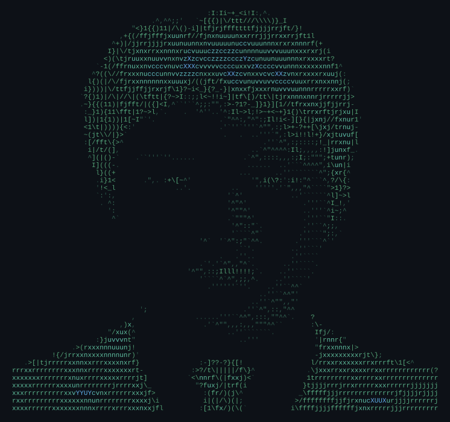

# HARRYjiang26-cell

<p align="center">
  <!-- Coloured ASCII portrait: rebuilt from avatar.png by scripts/ascii_avatar.py
       and rendered to SVG by scripts/colored_svg.py -->
  
</p>

<!-- STATS:START -->
```
HARRYjiang26-cell@github
------------------------------------
OS        : Windows 11 / Android
Uptime    : 0 months
Host      : GitHub
Kernel    : git lord_umberila
IDE       : VS Code
Shell     : PowerShell
Languages : Python
Hobbies   : coding, music, exploring
Contact   : HARRYjiang26-cell@github
Website   : —

- GitHub Stats
Repos     : 2    Stars     : 1
Commits   : 10    PRs       : 0
Issues    : 0    Followers : 0
Lines (est.): 600

_updated 2026-11-22 04:12 UTC_
```
<!-- STATS:END -->

---

<sub>Everything above is regenerated daily by <code>.github/workflows/update.yml</code>.</sub>
